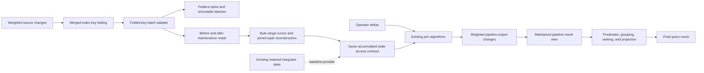
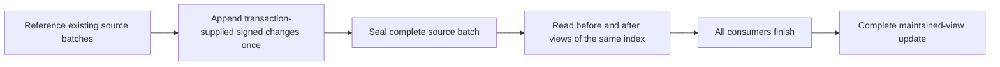

# Range-aligned incremental view maintenance

**Range-aligned IVM** supplies selected accumulated state to a logical delta program from
source records in a merged index. Compatible join/group key domains and the chosen physical
ordering align delta locations with the state ranges needed for maintenance. This is a future
integration design; the [native Q3 baseline](../../../sql-to-dbsp-compiler/experiments/q3-ivm-baseline/README.md)
uses ordinary Feldera state. The [implementation plan](range-aligned-ivm-native-q3-baseline-plan.md)
records the scope settled on 2026-10-01 and supersedes earlier assumptions about a fixed Q3 circuit.
The [compilation and run workflow](WORKFLOW.md) explains the native baseline's commands,
generated compiler/runtime graphs, raw artifacts, and provenance. All future
IVM maintenance runs use one DBSP worker. Initial loading may use multiple
workers. The IVM maintenance implementation targets single-worker execution; partitioning, cross-worker
exchange, distributed state placement, and migration are outside its current
scope. No multiworker maintenance extension is planned.

## Four architecture stages

1. **Author physical pipelines outside this project.** The user handwrites predicate-free,
   order-preserving physical pipelines whose operators share compatible orderings. Logical SQL
   alone does not establish that property. Pipeline composition is outside this project's scope.
2. **Define a merged index for the chosen pipeline.** Its constitution specifies source
   representations, compatible key domains, and folded keys. The implemented
   [COL constitution](folded-key-layer-file-plan.md#merged-index-constitution) makes customer,
   order, and line ranges available for reconstruction.
3. **Translate the pipeline result into logical SQL.** Define maintained result `V` (`J` in
   the earlier Q3 discussion) and obtain a DBSP program. SQL need not preserve the authored
   physical shape, and the physical plan used to load `V` may differ. R1 bootstraps and
   updates `V` through the same compiler-generated incremental circuit.
4. **Supply accumulated state to the logical `ΔV` program.** Replace selected independently
   maintained integrator traces with reconstructed state. Preserve logical delta computation,
   signed multiplicities, and before/after semantics. The logical IVM shape affects efficiency;
   it need not reproduce the original full-query physical plan.

An integrator denotes logical accumulation; a keyed retained trace is one physical realization
of its output. Native trace sharing means “one index per integrator” is an architectural
comparison, not an exact universal allocation count. Replacing a trace requires redirecting
its reads **and stopping its independent accumulation**. Base storage, the secondary merged
index, materialized `V`, and unreplaced operator state remain separately accounted for.

## Range alignment

Compatible join and grouping semantics define relevant key domains; folded-key design embeds
those domains in shared ranges. Delta records identify affected ranges, and source reads
reconstruct requested accumulated relations within common or nested prefixes. In COL, a customer
prefix contains order prefixes, which contain line prefixes. Different consumers may request
different levels of that hierarchy. Alignment requires neither identical leaf keys, a single
coordinated scan, nor global sorting of delta execution. A small customer delta can affect a
large descendant range. Grouping belongs to the broader architecture; R1's Q3 join has
no aggregation. See the [generated state-read contracts](native-state-read-contracts.md)
and [range-alignment discussion](support.md#range-alignment-and-native-state-read-contracts).

## References and how each helps

This guide lists all sources used by this note and its supporting report, grouped by source file. Detailed
line-level citations remain beside the claims they support. Start with the interesting-orderings manuscript
for general merged-index design, LeanStore for working storage and query execution, and the lecture note
for historical Q3 maintenance examples. Direct, query-specific reconstruction is the current implementation
choice within range-aligned IVM.
The validated `mi_db` scan-session section informs a deferred, optional sharing design;
validation does not extend to its other sections.
Local links assume the sibling checkout layout; public code links pin the inspected revisions. The modified
`mi_db` design is identified by revision and content hash in the supporting report.

### Design documents

| Reference | How it helps |
| --- | --- |
| [Interesting-orderings manuscript — general design](../../../../merged_index_interesting_orderings/main.tex#L515) | Primary design reference for order-sharing pipelines, heterogeneous folded keys, backend reuse, and the distinction between pipeline output and remaining query work. |
| [Multi-pipeline query execution manuscript](../../../../query_execution_using_MI/main.tex#L88) | Future direction: composing pipelines through intermediate views. Outside this project’s scope; single-pipeline maintenance provides groundwork. |
| [Maintaining a Query, One Change at a Time](../../../../DBSP_w_merged_index/dbsp-merged-index-feasibility.tex#L276) | Historical filtered, aggregate-first Q3 circuit and signed-delta algebra. Its five-state circuit is not the maintained view selected here. |
| [Equivalent Q3 circuits — figure source](../../../../DBSP_w_merged_index/figures/q3-dbsp-circuit.tex#L59) | Documents the historical grouping, delay, and join wiring for comparison. |
| [Operator-state guide](../../../../DBSP_w_merged_index/operator-state.tex#L39) | Historical aggregate-first example of group existence; grouping now belongs to the consuming query. |
| [mi_db validated scan-session design](../../../../mi_db/docs/architecture.md#merged-index-scan-sessions) | The scan-session section is validated. Other sections, including the separate buffer guard, require independent assessment. Sharing is deferred and optional; spill/reread are proposed extensions. |
| [Interesting-orderings manuscript — experiments](../../../../merged_index_interesting_orderings/sections/experiments_revised.tex#L173) | Defines the refresh workload and reports backend-dependent results, including the LSM comparison. It motivates measuring total maintenance cost rather than assuming a Feldera speedup. |

### Existing Feldera storage and operator behavior

| Reference | How it helps |
| --- | --- |
| [Read/write interfaces — trace.rs](https://github.com/feldera/feldera/blob/f3c06614f53b1c01e0f6b8745d690ad6a2bcac7c/crates/dbsp/src/trace.rs#L231-L308) | Defines weighted collections, the read interface, and insertion of immutable update batches; anchors the interface pseudocode. |
| [Key/value navigation — trace/cursor.rs](https://github.com/feldera/feldera/blob/f3c06614f53b1c01e0f6b8745d690ad6a2bcac7c/crates/dbsp/src/trace/cursor.rs#L42-L109) | Defines key-then-value iteration, forward seeks, borrowed values, and time/weight access. |
| [Spine batch management — trace/spine_async.rs](https://github.com/feldera/feldera/blob/f3c06614f53b1c01e0f6b8745d690ad6a2bcac7c/crates/dbsp/src/trace/spine_async.rs#L1-L7) | Shows the collection of immutable batches and background merging targeted for reuse. |
| [Read snapshots — trace/spine_async/snapshot.rs](https://github.com/feldera/feldera/blob/f3c06614f53b1c01e0f6b8745d690ad6a2bcac7c/crates/dbsp/src/trace/spine_async/snapshot.rs#L23-L43) | Defines snapshot acquisition, batch ownership/composition, and the combined cursor used for a stable read view. |
| [Weight consolidation — trace/cursor/cursor_list.rs](https://github.com/feldera/feldera/blob/f3c06614f53b1c01e0f6b8745d690ad6a2bcac7c/crates/dbsp/src/trace/cursor/cursor_list.rs#L150-L174) | Shows addition of weights across batches and suppression of zero totals in unit-time reads. |
| [File format — storage/file.rs](https://github.com/feldera/feldera/blob/f3c06614f53b1c01e0f6b8745d690ad6a2bcac7c/crates/dbsp/src/storage/file.rs#L3-L65) | Describes immutable nested groups, per-level tree indexes, associated data, and typed comparisons; constrains the merged-index batch adapter. |
| [Memory batches — trace/ord/vec/indexed_wset_batch.rs](https://github.com/feldera/feldera/blob/f3c06614f53b1c01e0f6b8745d690ad6a2bcac7c/crates/dbsp/src/trace/ord/vec/indexed_wset_batch.rs#L158-L199) | Shows sorted keys, value offsets, values, and weights underlying the worked layout example. |
| [Memory/file selection — trace/ord/fallback/indexed_wset.rs](https://github.com/feldera/feldera/blob/f3c06614f53b1c01e0f6b8745d690ad6a2bcac7c/crates/dbsp/src/trace/ord/fallback/indexed_wset.rs#L34-L58) | Confirms that retained indexed state can use either memory or file-backed batches. |
| [File batches — trace/ord/file/indexed_wset_batch.rs](https://github.com/feldera/feldera/blob/f3c06614f53b1c01e0f6b8745d690ad6a2bcac7c/crates/dbsp/src/trace/ord/file/indexed_wset_batch.rs#L447-L478) | Shows batched key fetching and, later in the file, key/value batch construction. Both matter when defining the baseline and adapter boundary. |
| [Timestamp specialization — time.rs](https://github.com/feldera/feldera/blob/f3c06614f53b1c01e0f6b8745d690ad6a2bcac7c/crates/dbsp/src/time.rs#L214-L219) | Shows that root-circuit unit time selects ordinary batches; distinguishes runtime timestamps from merged-index source versions. |
| [Incremental joins — operator/dynamic/join.rs](https://github.com/feldera/feldera/blob/f3c06614f53b1c01e0f6b8745d690ad6a2bcac7c/crates/dbsp/src/operator/dynamic/join.rs#L698-L749) | Establishes delta/current-state and delta/delayed-state wiring, plus the baseline batched-fetch path. |
| [Aggregation — operator/dynamic/aggregate.rs](https://github.com/feldera/feldera/blob/f3c06614f53b1c01e0f6b8745d690ad6a2bcac7c/crates/dbsp/src/operator/dynamic/aggregate.rs#L766-L796) | Explains generic aggregation’s retained-input and previous-output strategy, and explicitly discusses recomputing old values as an alternative. |
| [Output replacement — operator/dynamic/upsert.rs](https://github.com/feldera/feldera/blob/f3c06614f53b1c01e0f6b8745d690ad6a2bcac7c/crates/dbsp/src/operator/dynamic/upsert.rs#L90-L109) | Draws the retained-output feedback used to turn replacement values into old-tuple retractions and new-tuple insertions. |
| [Transaction scheduling — circuit/schedule.rs](https://github.com/feldera/feldera/blob/f3c06614f53b1c01e0f6b8745d690ad6a2bcac7c/crates/dbsp/src/circuit/schedule.rs#L186-L226) | Shows why a transaction may span multiple runtime steps and why one exhausted cursor is not a completion barrier. |
| [Commit handling — circuit/circuit_builder.rs](https://github.com/feldera/feldera/blob/f3c06614f53b1c01e0f6b8745d690ad6a2bcac7c/crates/dbsp/src/circuit/circuit_builder.rs#L7777-L7805) | Provides the commit-flushing behavior that must be considered when retiring old views and publishing batch progress. |

### RocksDB comparison and LeanStore implementation evidence

| Reference | How it helps |
| --- | --- |
| [RocksDB overview](https://github.com/facebook/rocksdb/wiki/RocksDB-Overview) | Supplies the familiar memtable/SST and key-value baseline for the storage comparison. |
| [RocksDB merge operator](https://github.com/facebook/rocksdb/wiki/Merge-Operator) | Explains application-defined update combination; prevents treating weighted addition as a capability RocksDB lacks. |
| [LeanStore B-tree merged-index adapter](https://github.com/alicia-lyu/leanstore/blob/305ad0a98b147d048a37a1eba3787b35b1181b85/frontend/shared/adapter-scanner/LeanStoreMergedAdapter.hpp#L25) | Working B-tree storage with record-specific folded byte keys and payloads. |
| [LeanStore RocksDB merged-index adapter](https://github.com/alicia-lyu/leanstore/blob/305ad0a98b147d048a37a1eba3787b35b1181b85/frontend/shared/adapter-scanner/RocksDBMergedAdapter.hpp#L22) | Working LSM storage for the same merged-index design. |
| [LeanStore Q3 execution](https://github.com/alicia-lyu/leanstore/blob/305ad0a98b147d048a37a1eba3787b35b1181b85/frontend/tpch/q3/query.tpp#L446) | Executes the Customer–Orders–Lineitem scan, per-order aggregation, and final top-10 selection; does not establish the proposed incremental maintenance. |
| [LeanStore Q5 implementation](https://github.com/alicia-lyu/leanstore/blob/305ad0a98b147d048a37a1eba3787b35b1181b85/frontend/tpch/q5/query.tpp#L219-L335) | Shows the external Nation/Region eligibility check, supplier-field use, and actual date bounds that a Q5 comparison must preserve. |
| [LeanStore Q10 logical plan](https://github.com/alicia-lyu/leanstore/blob/305ad0a98b147d048a37a1eba3787b35b1181b85/frontend/tpch/q10/plans/family_logical.dot#L34-L69) | Establishes the selected join boundary and downstream aggregation, without assuming a stored per-order summary. |
| [LeanStore Q10 visitor](https://github.com/alicia-lyu/leanstore/blob/305ad0a98b147d048a37a1eba3787b35b1181b85/frontend/tpch/q10_family/visitor.hpp#L126-L200) | Shows the customer and returned-line payloads needed by downstream consumers. |
| [LeanStore Q10 date bounds](https://github.com/alicia-lyu/leanstore/blob/305ad0a98b147d048a37a1eba3787b35b1181b85/frontend/tpch/q10/query.tpp#L100-L107) | Supplies the concrete day-offset predicate, which must be matched rather than assumed equivalent to a calendar interval. |
| [LeanStore refresh discovery](https://github.com/alicia-lyu/leanstore/blob/305ad0a98b147d048a37a1eba3787b35b1181b85/frontend/tpch/tpch_family/refresh.hpp#L143-L178) | Shows RF2 parent lookup and line-number discovery; clarifies what additional payload retention is needed to share these reads. |
| [LeanStore merged-index maintenance](https://github.com/alicia-lyu/leanstore/blob/305ad0a98b147d048a37a1eba3787b35b1181b85/frontend/tpch/tpch_family/col_pipeline.tpp#L150-L220) | Shows insertion and erasure paths whose read/write work must be included in maintenance accounting. |

### Detailed explanations in this repository

| Reference | How it helps |
| --- | --- |
| [Native Q3 baseline experiment](../../../sql-to-dbsp-compiler/experiments/q3-ivm-baseline/README.md) | Implements native incremental bootstrap and refreshes; the circuit note maps generated joins and state reads, and the results note records verification and measurements. |
| [Generated native state-read contracts (R2)](native-state-read-contracts.md) | Binds all four generated accumulated reads to concrete types, before/after states, runtime snapshots and cursors; records prototype gaps for R3. |
| [Storage differences from RocksDB](support.md#storage-differences-from-rocksdb) | Connects the baseline comparison to concrete storage sources. |
| [Trace access traverses keys then weighted values](support.md#trace-access-traverses-keys-then-weighted-values) | Provides interface pseudocode, an array layout, traversal/lookup examples, and interchangeable read providers. |
| [Folded keys in Feldera layer files](support.md#folded-keys-in-feldera-layer-files) | Defines the record representation and weighted-update requirements for reusing the LSM machinery. |
| [Direct reconstruction is the chosen access path](support.md#direct-reconstruction-is-the-chosen-access-path) | Explains selective maintenance reads, query/integrator-controlled lookup, and the demonstrated native storage substrate. |
| [Batch ownership and operator access](support.md#batch-ownership-and-operator-access) | Preserves snapshot lifetime, weighted visibility, cursor ordering, and transaction-completion requirements for direct reconstruction. |
| [Shared scan sessions bound ownership and memory](support.md#shared-scan-sessions-bound-ownership-and-memory) | Records a deferred, optional coordination abstraction for full-query execution or IVM, including reader positions and bounded overflow behavior. |
| [Merged index reconstructs integrator outputs](support.md#merged-index-reconstructs-integrator-outputs) | Maps predicate-free join state to reconstruction routines and the existing join operator contract. |
| [Weighted reconstruction preserves group existence](support.md#weighted-reconstruction-preserves-group-existence) | Explains signed multiplicity and defers grouped existence to the consuming Q3 query. |
| [Immutable batches preserve old reads](support.md#immutable-batches-preserve-old-reads) | Separates existing snapshot primitives from the publication/recovery behavior the adapter must implement. |
| [Consumers determine the required payload](support.md#consumers-determine-the-required-payload) | Summarizes Q5/Q10 requirements that prevent replacing every requested relation with a revenue total. |
| [Refresh reads can serve reconstruction](support.md#refresh-reads-can-serve-reconstruction) | Identifies shareable RF1/RF2 work and the limits of existing refresh evidence. |
| [Evidence and measurements bound the claim](support.md#evidence-and-measurements-bound-the-claim) | Records source provenance, acceptance criteria, and the measurements still needed. |

## Feldera pipelines and intermediate views

A **Feldera pipeline** is a compiled SQL program of input tables and dependent views, together with its
connectors and runtime configuration. Views can refer to other views in the same program, and Feldera
incrementally maintains the resulting computation as input tables change. This is distinct from the
**order-sharing pipeline** in this note: a portion of a query whose operators share compatible tuple
orderings. Maintaining one such portion inside a Feldera pipeline does not require composing multiple
Feldera pipelines. See the [Feldera pipeline API](https://docs.feldera.com/api/) and the
[repository overview](../../../README.md).

Feldera permits explicit, named intermediate SQL views. `CREATE LOCAL VIEW` defines an intermediate
calculation for dependent views without exposing its change stream as a pipeline output. `CREATE VIEW`
exposes output changes; `CREATE MATERIALIZED VIEW` also retains the complete current result for ad-hoc
queries and snapshots. In the intended decomposition, local SQL views belong at order-destroying boundaries.
`B` below names the actual generated Orders–Customer intermediate, not a required SQL declaration.
R1 declares one three-way view and lets the compiler choose its shape; the
[R2 contracts](native-state-read-contracts.md#relations-and-state-notation) record that choice. See the
[SQL view grammar](https://docs.feldera.com/sql/grammar/) and
[materialized-view behavior](https://docs.feldera.com/sql/materialized/).

An incremental join still needs accumulated, keyed state for its inputs so that new changes can match
existing rows. Feldera's compiler creates the required join indexes and its runtime maintains input
traces internally; declaring a materialized SQL view or SQL `CREATE INDEX` is not required for this
purpose. An input trace represents the state needed for future maintenance, not necessarily an event log
of every update. This design proposes reconstructing selected accumulated integrator outputs from the
merged index instead of retaining separate traces. That proposed storage substitution is separate from
the user's choice to name intermediate SQL views or materialize queryable results. See the
[join implementation](../../../crates/dbsp/src/operator/dynamic/join.rs#L663) and the
[SQL index rules](https://docs.feldera.com/sql/grammar/#creating-indexes).

### Secondary storage scope

The scope settled on 2026-09-30 retains Feldera's existing base-relation storage. A primary-key
input map maintains current base rows in a trace so updates can retract the old row. The merged
index is additional secondary storage, serving selected operator reads in the same role as
other retained operator traces. Using a merged index as clustered primary storage is deferred.

Adding this secondary index does not remove the source trace or automatically replace another
operator trace. A selected operator trace is replaced only when runtime wiring redirects its
consumers and stops maintaining that trace. Storage accounting must include base state, the
merged index, and all remaining operator state. Feldera can already reuse a source trace for
materialized input reads; that does not imply sharing with our different folded representation.
See the [settled storage scope](folded-key-layer-file-plan.md#settled-scope-before-phase-4).

Reuse Feldera's native signed merging. K uniqueness should follow from enforced source keys,
identity-preserving folding, and correct secondary-index maintenance; R3 must establish
those conditions for the actual source and recovery paths. No new merger or mandatory
changed-key validation scan is planned. The former Phase 3 plan is withdrawn. The
[Phase 4 plan](phase-4-file-backed-storage-implementation-plan.md) verifies native
memory-to-file compaction and snapshot reads directly.

## How Feldera stores indexed state

> [!NOTE]
> **Glossary**
>
> **Retained state** — An integrator's accumulated output stored and maintained across input updates.
> Reads obtain its tuples from that maintained collection, which may reside in memory or files.
>
> **Reconstructed state** — The same integrator output computed for requested keys and a before/after view
> from stored weighted source records, instead of maintaining that output as a separate collection.
>
> Both supply the same tuples, weights, group presence/absence, and cursor ordering to the existing IVM
> path. Neither term refers to reconstructing input deltas. Reconstructed state still depends on retained
> source data and may use bounded temporary buffers; the distinction is how the integrator output is supplied.
>
> **root circuit** — top-level operator graph.
>
> **Order-sharing pipeline** — Consecutive query operators that use compatible tuple orderings.
>
> **Residual execution** — Query work performed over the maintained pipeline result to produce the final result.

Reuse Feldera's LSM machinery with folded byte keys and weighted payload rows for the merged index. Reconstruct
accumulated relations from that store while preserving join and aggregation algorithms. The adapter changes
record representation and accumulated-state access; it does not require a separate LSM implementation.
The target is maintenance of the result of one **order-sharing pipeline** in a nonrecursive **root circuit**.
Its maintained view needs **residual execution**: Q3's predicates, revenue aggregation, ordering, limit,
and projection run in the consuming query.
The [interesting-orderings design](../../../../merged_index_interesting_orderings/main.tex#L751)
explicitly allows a pipeline to be only part of a query. Internal integrator reconstruction does not remove
the maintained pipeline result. Rust interfaces and implementation are subsequent work.
Composing multiple pipelines is outside scope; this project provides groundwork for the
[multi-pipeline query execution design](../../../../query_execution_using_MI/main.tex#L88).

Compared with RocksDB, the relevant differences are the update semantics and the representation supplied to
storage:

> [!NOTE]
> **Glossary**
>
> **Z-set** — relation with signed tuple multiplicities.
>
> **batch** — immutable sorted collection of weighted updates, in memory or a file.
>
> **spine** — Feldera's collection of immutable batches and background merger.

| Aspect | RocksDB | Feldera |
| --- | --- | --- |
| Update semantics | `Put` replaces a key's value; `Delete` removes it. An application-defined `Merge` operator can combine updates. | A **Z-set** adds weights for identical complete tuples and drops zero totals. An indexed Z-set groups weighted values by key. |
| Unit supplied to accumulated storage | Ordinary writes enter a mutable memtable before becoming immutable sorted runs. | A **batch** enters a **spine**. A storage batch is distinct from an input update batch. |
| Indexed record layout | A sorted key-to-value mapping. | `K → {V → weight}`: each search key has a sorted group of weighted values; equivalently, `(K,V) → weight`. |

> [!NOTE]
> **Glossary**
>
> **columns** — storage nesting levels, not SQL attributes.
>
> **Trace** — Feldera's name for its interface to retained, weighted state. The name appears in its code;
> this design does not require provenance from a particular research system.
>
> **`Operator::flush`** — A weird Feldera naming choice: finish processing the transaction's
> inputs and emit remaining outputs. In the native join, it coordinates complete delta inputs
> with before/after trace snapshots; it does not mean a memory-to-storage flush. See the
> [naming note and join example](native-state-read-contracts.md#weird-feldera-naming-flush).

For a join keyed by customer ID, `K` is that ID and each `V` can be a complete order tuple. Each file-backed
batch indexes keys and nested value groups. The format calls these levels **columns**. The outer level is ordered by
`K`; within each fixed `K`, values are ordered
by `V`. Inner seeks compare `V`, and consolidation combines weights for identical `(K,V)` tuples across batches.
This describes existing operator state.
Feldera exposes retained state through the **trace** interface. `Spine` implements this interface
by holding immutable sorted batches and merging them in the background. See [Storage differences from
RocksDB](support.md#storage-differences-from-rocksdb).
An incoming operator delta can be buffered in memory, while an immutable storage batch can be memory backed
or file backed. Once the adapter appends complete pending changes to the same merged index, its cursor can
seek them before view maintenance. File backed batches remain on disk; cursors read indexed blocks as needed.
Snapshot references do not load every referenced batch into memory.
[Trace access traverses keys then weighted values](support.md#trace-access-traverses-keys-then-weighted-values)
shows interface pseudocode, array layout, cursor traversal, and the merged-index adapter.

In this root circuit, logical time has a single value, written `()` in Rust, so records need no varying
logical timestamp. Feldera's file batches also support fetching multiple requested keys together; retain
that optimization in the baseline comparison.

## What changes in our design

The [storage Step 2 plan](folded-key-layer-file-plan.md) records the current implementation contract and the
user's clarifications: folded keys, weighted payload rows, transaction-supplied related-row
changes, and temporary read handles without multi-versioning or expiration policies.
The [Phase 1 implementation note](phase-1-implementation-note.md) records the verified
encoding and two-column layer-file fixture.
The [Phase 2 implementation note](phase-2-implementation-note.md) records native
consolidated memory reads. The [Phase 4 implementation plan](phase-4-file-backed-storage-implementation-plan.md)
specifies native Spine storage and snapshot tests; the
[Phase 4 implementation note](phase-4-implementation-note.md) records the resulting evidence.

> [!NOTE]
> **Glossary**
>
> **Folding** — Encoding a source's key fields into bytes using a rule owned by a particular
> merged index.

Following the [primary folded-key design](../../../../merged_index_interesting_orderings/main.tex#L545),
the merged index uses standard KV storage: `index.fold(source, record) → encoded_value`.
**Folding** produces the byte key. Handwritten static source indexes currently select base
relations, ordered key fields, and payload fields; the Customer–Orders–Lineitem merged index
assigns shared domain and source tags in its
[constitution](folded-key-layer-file-plan.md#merged-index-constitution). A
[future SQL compiler generator](folded-key-layer-file-plan.md#future-static-code-generation)
is planned to emit these definitions. The index's logical
customer-leading positions are `(c)`, `(c,o)`, and `(c,o,l)`. Another merged index may fold
one of these sources differently. A generic `MergedIndex<D>` base holds shared folding and
storage behavior; `CustomerOrdersLineitemIndex` wraps it with this index's definition. The
storage layer compares opaque byte strings lexicographically. It does not expose those fields
as nested groups.
The encoding must preserve the intended cross-type ordering and let the access layer construct range bounds.

Each value contains one regular payload and its signed weight. The index
identifier in the folded key determines the record type; `INDEX` is its domain tag, not an extra end marker.
At a completed transaction boundary, each folded K has at most one active payload. A replacement
delta can carry negative and positive contributions with the same K; a post-append read can return
multiple nonzero payloads for that K if the source-state invariant is violated.
Phase 2 returns Feldera's `CursorList` over existing batch cursors. Reads consolidate complete
`(K, payload)` pairs and omit zero totals without changing the stored batches. Source uniqueness and
correct index maintenance must establish the
[folded-K invariant](folded-key-layer-file-plan.md#inherit-k-uniqueness-from-source-state).
Feldera's layer-file columns store folded K and its weighted payload rows; no payload list or key suffix
is added.
A range cursor reads KV entries in byte-key order and
decodes the fields needed by the requesting operator. For Q3, it streams one order's source rows to supply
requested joined tuples before and after maintenance. It does not build an in-memory relation containing
all those lines.
The transaction supplies complete extended records and any intended related-row changes,
available before the associated join maintenance runs. Storage does not
add an `OrderParent` record, perform reverse-parent lookup, or move child rows automatically. Reuse the spine, batch
management, compaction, cache, snapshots, and signed merge rules; supply the folded key and payload
representation. Standard `OrdIndexedWSet` batches already support memory and file storage;
native compaction chooses when to write files.
Payload replacement must preserve both payloads and signed changes; ordinary last-write-wins handling alone
cannot implement weighted reconstruction. [Folded keys in Feldera layer
files](support.md#folded-keys-in-feldera-layer-files)
defines this boundary and the remaining adapter work.

> [!NOTE]
> **Glossary**
>
> **integrator state** — logical results of accumulating changes, supplied by retained or reconstructed state.

The integration boundary is **accumulated-state access**: for requested keys and the state before or after
maintenance, return the
same tuples, weights, ordering, and absence information that existing **integrator state** would supply.
For the current experiments, ad-hoc routines for each query and integrator control their own source
lookups and reconstruct only the requested accumulated state. Native join execution remains the current
integration constraint. Trace access is the principal
substitution point, but partitioning, batched fetches, cursor-driving choices, sorting, and batch
construction also determine its state-read contracts. Reconstruction must satisfy those contracts. The
[direct-reconstruction decision](support.md#direct-reconstruction-is-the-chosen-access-path) explains why
limited maintenance ranges reduce the motivation for shared scan coordination. A scan-operator layer
remains an architectural option for both full-query execution and IVM.

The existing incremental view maintenance (IVM) algorithm determines the output: an additive summary can
emit a tuple carrying a value difference; a replacement emits `-[[old_tuple]] + [[new_tuple]]`, where `[[t]]`
denotes one copy of tuple `t`. The merged index can supply state for either algorithm. Choosing the delta
form and computing it remain in the shared operator path. Returned tuples are streamed or buffered within
a byte limit, without storing another complete accumulated relation.

> [!NOTE]
> **Glossary**
>
> **Sealing** — Making the complete pending update set immutable and available to readers.



One storage owner appends each complete input delta to the same index before view maintenance, publishes
consistent views, and keeps them alive for every
consumer. Provider cursors seek encoded ranges and return the requested state through the shared contract. When
byte-key order differs from the required operator order, use budgeted external sorting or a maintained access
path and count its I/O. Direct routines must budget temporary records and respect borrowed-value lifetimes.
[Batch ownership and operator access](support.md#batch-ownership-and-operator-access) describes the
snapshot and completion requirements independently of scan sharing.
[Shared scan sessions](support.md#shared-scan-sessions-bound-ownership-and-memory) remain a deferred,
optional abstraction if later workloads justify coordinated readers. Their basis is the validated
`mi_db` scan-session section; the Feldera adaptation and overflow extensions remain proposals.

The reconstruction target is a requested accumulated relation, not an input delta stream.
The compiler determines actual Q3 read sites; `B = O ⋈ C` is an illustrative relation only.
The [native baseline circuit](../../../sql-to-dbsp-compiler/experiments/q3-ivm-baseline/CIRCUIT.md)
records the generated shape rather than prescribing this illustration. The
[lecture note's filtered, aggregate-first Q3 circuit](../../../../DBSP_w_merged_index/dbsp-merged-index-feasibility.tex#L276)
is a historical alternative with a different maintained-view boundary.

## How Q3 works with reconstructed state

Maintain the unfiltered, unaggregated logical Customer–Orders–Lineitem join `V = J`.
Logical `L` has order and line identities, without customer ID; it joins Orders on order ID.
`B` is the generated Orders–Customer intermediate, joined on customer ID and keyed by order ID.
The [R2 contracts](native-state-read-contracts.md) specify its projection and accumulated reads.
Customer-led extended Lineitem records are physical merged-index representations. Producing them
is a separate index/view maintenance problem. Corresponding extended records and related key
changes are assumed supplied and available **before associated join maintenance runs**; they
locate logical `ΔL` physically without changing its schema. Storage does not infer those changes.

| Relation | Required fields and multiplicity | Source access in a future provider |
| --- | --- | --- |
| `O` | Order ID, customer ID, order date, ship priority, signed weight | Order records. |
| `C` | Customer ID, market segment, signed weight | Customer records. |
| Generated `B` | Order ID key; customer ID, market segment, order date, ship priority; joined weight | Customer and order source records; order-ID requests are a documented compatibility gap. |
| Logical `L` | Order ID, line ID, ship date, extended price, discount, signed weight | Physical extended records also carry the customer prefix. |
| Maintained `V = J` | Customer, order, and line identities; market segment, order date, ship priority, ship date, price, and discount; joined weight | Separate materialized pipeline result. |

Line identity stays in `J`: two lines with identical visible Q3 fields still represent two joined rows.
Neither source scans nor the maintained join apply market-segment or date predicates. Q3's consuming query
filters `J`, computes `SUM(extended_price * (1 - discount))` per order/date/priority, then orders by revenue
and order date and takes the first ten rows. In SQL-like notation:

```sql
SELECT order_id, SUM(extended_price * (1 - discount)) AS revenue,
       order_date, ship_priority
FROM J
WHERE market_segment = :segment
  AND order_date < :cutoff
  AND ship_date > :cutoff
GROUP BY order_id, order_date, ship_priority
ORDER BY revenue DESC, order_date
LIMIT 10;
```

For any accumulated relation `X`, `X⁻` is state immediately before the update set and `X⁺`
is state afterward; `ΔX = X⁺ − X⁻`, so `X⁺ = X⁻ + ΔX`. The superscripts identify states,
not negative and positive tuple weights. Unchanged tuples belong to both states.
For a joined relation, Feldera's incremental join uses a before-state input on one branch and an
after-state input on the other, so simultaneous changes contribute once. If a line changes price and its
customer changes segment in the same supplied update set, the maintained `J` retracts the old joined row
and inserts the new joined row. The consuming Q3 query then evaluates its predicates on the resulting rows.
The [weighted reconstruction rules](support.md#weighted-reconstruction-preserves-group-existence)
and existing operator bindings determine the signed weights; the storage adapter does not choose a new join
algorithm.

> [!NOTE]
> **Glossary**
>
> **support** — tuples with nonzero weight.

An optional shared traversal of an order range could supply line tuples to multiple readers
and reuse decoded parent payloads; direct readers can instead open their own ranges. A customer change affects
its descendant orders in the before and after states. Discover
affected identities from the **support** of complete signed changes: projecting a replacement to K and
summing first can cancel its weights and hide a changed row. Consumers that share decoded
records need independent positions. A slow consumer can pin buffers, so bounded sharing must account for
spilling or rereading oversized ranges.

> [!NOTE]
> **Glossary**
>
> **Rekeying** — Moving records to a changed physical key prefix.



Before-maintenance reads use the snapshot taken before the append. After-maintenance reads use the snapshot
taken afterward, which includes the signed changes. The same input delta remains available separately to
the existing operators. No record status bit is needed: snapshot membership determines which contributions
each read sees. If `S` is the pre-append index state and `D` the signed delta, `X⁻`
is read from `S` and `X⁺` from `S + D`. A negative weight in `D` retracts an old payload in `X⁺`;
it does not place that delta record in `X⁻`. See the
[runtime compatibility contract](folded-key-layer-file-plan.md#compatibility-with-feldera-operators).
The transaction explicitly supplies any intended Lineitem placement changes; storage neither invents
related-row updates nor enforces relational consistency. Completion does not append the same delta again.
Snapshots reference existing batches without copying their tuples or files.
[Immutable batches preserve old reads](support.md#immutable-batches-preserve-old-reads) explains the lifecycle
requirements and what remains to implement.

Q5 and Q10 add two useful constraints. Q5 needs a consistently observed external Nation/Region relation
and line supplier identifiers. Q10 needs returned line rows and customer payloads for downstream work.
The maintained Q3 join likewise retains the source fields needed by its consuming query.
See [Consumers determine the required payload](support.md#consumers-determine-the-required-payload).

## Why this could improve I/O

The hypothesis is that avoiding selected retained intermediate collections reduces writes;
R1 only establishes the native baseline, and any saving requires measurement. Source changes
still incur KV update, consolidation, and persistence work, but a selected reconstructed intermediate need not have
separate accumulated storage. Co-location also lets several logical consumers use one physical range read.
Neither benefit implies that every update becomes cheaper.

Refresh processing offers another sharing opportunity. RF1 inserts an order and its lines: customer reads
can serve the join, and appended rows can supply after-state reconstruction. RF2 supplies deletion changes
for an order and its lines: before-state range reads can supply operator inputs. The cited LeanStore workload
also performs native-order discovery; that is reference behavior, not a required lookup in this Q3 adapter.
Sharing reads requires keeping full decoded payloads until consumption; discovery that
collects only identifiers does not achieve that reuse.
[Refresh reads can serve reconstruction](support.md#refresh-reads-can-serve-reconstruction) distinguishes the
existing refresh behavior from the proposed sharing.

Reconstruction trades writes and persistent intermediate bytes for reads, decoding, and computation. A single
line change may rescan all `f` lines of its order; a customer change may visit every descendant. Transaction-supplied
key changes write the supplied before and after placements. Temporary read handles, incoming batches,
reconstruction buffers, and any additional ordering increase memory or peak storage. Existing Feldera
traces may answer selective probes more cheaply, especially with cached or batched fetches.

Judge the design against unmodified Feldera with identical results, updates, memory budgets, and comparable
durability. Measure actual read/write bytes, repeated reads, seeks, decoded records, CPU, peak memory and
storage, and complete-batch latency. Include any workload-side refresh discovery, staging, compaction,
checkpointing, spills, and writes to the maintained pipeline result. Hold residual query execution constant
and report its cost separately from maintenance. The union of touched blocks describes potential reuse;
device read events measure realized traffic. Test beyond-memory state with both localized refresh groups
and scattered updates, including
large descendant ranges.

The design sources specify weighted reconstruction semantics; implementation correctness, recovery, and
the I/O improvement remain to be established. First verify reconstructed integrator outputs and IVM deltas
against independent evaluation, then verify snapshot and scheduling behavior, and finally measure total
maintenance cost.
[Evidence and measurements bound the claim](support.md#evidence-and-measurements-bound-the-claim) gives the
source provenance and implementation acceptance criteria.

## Next Steps

The roadmap uses **R1–R5**. These labels are distinct from the older
**storage Step 2** and its Phase numbering, which remain in the storage plans and notes.

1. **R1 — Native baseline.** The [experiment](../../../sql-to-dbsp-compiler/experiments/q3-ivm-baseline/README.md)
   uses one predicate-free materialized SQL view, default optimization, Catalog mode, and native
   incremental bootstrap/update execution. Inspect its actual state reads, compare signed deltas
   and snapshots with independent full joins, and measure load and RF1/RF2 separately. Defaults
   are one worker, 10,000-row load batches, three independent runs, and memory-backed state.
   The generated grouping is Orders–Customer first, then Lineitem–joined-orders; both joins
   have the opposite left/right orientation from the written SQL. This preserves its grouping,
   while the [circuit note](../../../sql-to-dbsp-compiler/experiments/q3-ivm-baseline/CIRCUIT.md)
   records actual before/after read choices. See [verified results](../../../sql-to-dbsp-compiler/experiments/q3-ivm-baseline/RESULTS.md)
   for executed checks and measurements.
2. **R2 — State-read bindings.** The [completed contracts](native-state-read-contracts.md)
   identify all four generated accumulated reads, concrete key/value types, before/after
   semantics, and existing snapshot, fetch, and cursor behavior at the inspected revision.
   They record compatibility gaps with the [native storage substrate](phase-4-implementation-note.md).
3. **R3 — Direct reconstruction.** Investigate those compatibility gaps and implement the
   generated bindings. Redirect selected reads and stop replaced accumulation. Reconstruction,
   ordering, memory, publication, and recovery decisions belong to this implementation stage.
   Shared scan sessions remain optional.
4. **R4 — Correctness verification.** Compare native and reconstructed reads, deltas, and `V` with
   independent evaluation for simultaneous changes, replacements, distinct lines with identical
   payloads, fan-out, and supplied key moves. Verify residual Q3 separately.
5. **R5 — Maintenance measurements.** Compare beyond-memory state under equal total memory and
   comparable durability, including discovery, reads, writes, sorting, spill, and background work.
   R1 supplies a baseline and makes no performance-gain claim. Extend to Q5/Q10 after Q3
   integration passes its [acceptance criteria](support.md#evidence-and-measurements-bound-the-claim).
