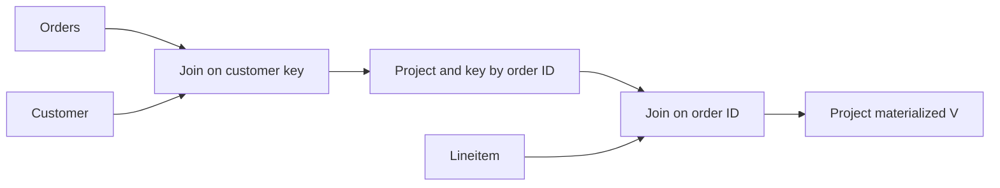
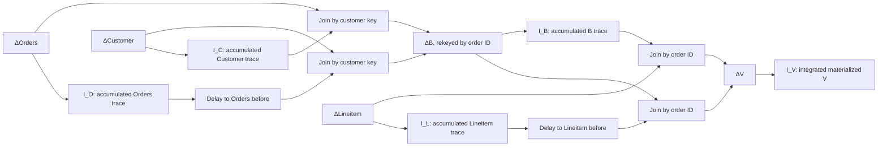

# Generated native circuit for `V`

This document describes the circuit generated from [query.sql](query.sql) by
the repository compiler against its pinned Calcite commit
`f840e7ab3f8121e71035a7a1ed3fc1372f0139d5` (Calcite
`1.43.0-SNAPSHOT`). The exact invocation is [generate.sh](generate.sh): `-i`
enables incremental compilation, Catalog mode is the default, and omission of
`-O` selects optimization level 2. The checked-in [relational plan](plan.json)
and [generated Rust](src/lib.rs) are the evidence for this particular SQL
program and compiler revision.

## Optimized relational shape

The relational plan scans Orders and Customer, joins them on customer key,
projects their needed fields, and joins the result with Lineitem on order key.
The logical Lineitem input has `(l_orderkey, l_linenumber)` identity and no
customer key; the second join uses `l_orderkey = o_orderkey`.
It then projects the nine fields of `V`. These are plan nodes 2, 3, 4, 5, 1,
6, 7, and 8 respectively in [plan.json](plan.json). The SQL statement itself
starts with `Customer JOIN Orders`; the actual optimized plan's first join has
Orders on the left. The compiler's [hypergraph
step](../../SQL-compiler/src/main/java/org/dbsp/sqlCompiler/compiler/frontend/calciteCompiler/optimizer/CalciteOptimizer.java#L383)
is eligible for an unhinted query with more than one join, but eligibility
alone does not establish what it changed. The plan file records the result.



`B` labels the generated join output [s6](src/lib.rs#L487) for discussion; it
is not a SQL view. The compiler rekeys Orders by customer key in
[s3](src/lib.rs#L442), Customer by customer key in [s4](src/lib.rs#L456), and
Lineitem by order key in [s5](src/lib.rs#L465). It computes `s6` with
`s3.join_index_balanced(&s4)` and `s7` with `s5.join_balanced(&s6)` in
[generated Rust](src/lib.rs#L487). The latter produces the nine-column delta
of `V`. The generated file imports star-join helpers but calls neither one;
the experiment uses the compiler's default settings without an opt-out. A
[materialized output registration](src/lib.rs#L641) retains `V` and
exposes both a signed delta handle and an integrated snapshot.

## Expanded incremental shape

`ΔO`, `ΔC`, and `ΔL` are the changes emitted by the three primary-key input
maps. The map inputs and their retained base state are created by
[`add_input_map_persistent`](src/lib.rs#L79), with Catalog registrations for
Customer, Orders, and Lineitem. The join's indexed projections are logical
delta streams; the runtime maintains keyed traces of their accumulated
relations. For the default one-worker configuration,
[`join_balanced`](../../../crates/dbsp/src/operator/dynamic/join.rs#L866)
delegates to [`dyn_join_generic`](../../../crates/dbsp/src/operator/dynamic/join.rs#L651).
For multiple workers, it uses balanced trace accumulation and registers a
balancer. Both paths retain the same two algebraic branches per join.



With `O₀`, `C₀`, `L₀`, and `B₀` denoting state before the transaction, the
generated branch orientation is:

```text
ΔB = ΔO ⋈ (C₀ + ΔC) + O₀ ⋈ ΔC
ΔV = ΔL ⋈ (B₀ + ΔB) + L₀ ⋈ ΔB
V_after = V_before + ΔV
```

This is the orientation of the actual generated calls: Orders is left of
Customer, and Lineitem is left of `B`. In
[`dyn_join_generic`](../../../crates/dbsp/src/operator/dynamic/join.rs#L700),
each input's retained trace supplies the opposite branch. The left delta
joins the right trace after its current change; the right delta joins a
delayed left trace, giving the before state. Signed weights multiply in the
joins and add at the branch unions, so insertions, deletions, replacements,
and concurrent changes are represented in the same circuit. The
materialized-output registration requests a gathered integral. In the default
solo layout, [the Catalog
path](../../../crates/adapters/src/static_compile/catalog.rs#L130) uses
`shard_accumulate_integrate_trace_legacy`, and
[the snapshot handle](../../../crates/adapters/src/static_compile/catalog.rs#L643)
reads that integral. The primary-key input maps retain base storage too.
Here `I_O`, `I_C`, `I_L`, and `I_B` denote logical accumulation. Their keyed
traces are physical realizations supplying the join consumers; native sharing
and extra indexes mean there is no universal one-index-per-integrator
allocation count.

The join runtime also [partitions and fetches trace
ranges](../../../crates/dbsp/src/operator/dynamic/join.rs#L1661), chooses a
cursor-driving side from key estimates, and builds sorted output batches.
These physical details are part of the native baseline's state-read contract.
The source program does not route trace reads through a merged index.

The driver submits base records as transactions to this incremental circuit.
The initial load is therefore bootstrap through `ΔO`, `ΔC`, and `ΔL`, with
empty before state. It does not run a separate full-query evaluator. Later RF1
and RF2 transactions use the same circuit and materialized output. The
independent full join in [main.rs](src/main.rs) is a checker outside the
measured native transaction call.
